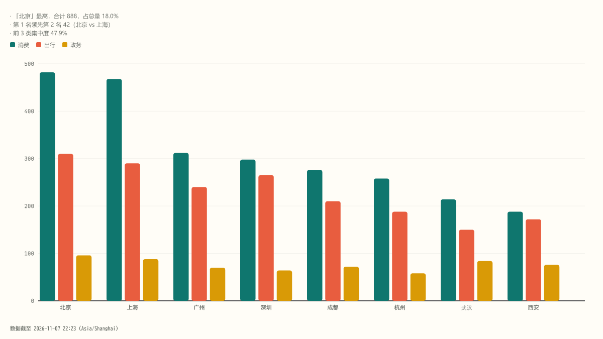

# Virta

[简体中文](README.md) · **English**

> Data in motion.

**Virta** is an offline-first, agent-friendly visualization CLI: feed it a CSV/JSON/XLSX file (or a Markdown document) and it detects the structure, recommends views, produces insights, and emits **zero-dependency single-file HTML** (opens offline, interactive) plus SVG/PNG static charts.



> Note: CLI messages and generated report copy are in Simplified Chinese.

## Installation

Requires Node ≥ 22. Install the tarball from GitHub Releases (no repo clone needed):

```bash
npm i -g https://github.com/hfut2014211610/virta/releases/download/v0.2.0/virta-0.2.0.tgz
virta doctor    # environment check: Node / resvg / runtime scripts / fonts / CJK glyphs / temp dir
```

Fix any `doctor` error before continuing.

## 5-minute quickstart

```bash
virta --version
virta doctor
virta list
virta render @samples/sample-multi.csv --export html,svg,png --out ./out --json
virta demo retail --out ./virta-demo --json
virta guide
virta skill path
virta skill install --dir ./skills
```

- The `@samples/` prefix references built-in samples (e.g. `@samples/sample-multi.csv`) and works from any directory.
- `virta demo <pack>` uses built-in scenario packs (retail / saas / quality / delivery / finance, `--all` for all of them) to produce a story page + linked dashboard + card PNGs in one shot.
- Use `-` for stdin; `--data '<json>'` passes data inline; `--json` outputs a machine-readable envelope (the `files[]` receipt lists artifact paths and sizes).

Common flags: `--view <view|auto>`, `--export html,svg,png`, `--out dir`, `--theme light|dark`, `--palette signal|patina|mono`, `--set k=v` (e.g. `--set variant=stacked`), `--spec <file.json>` (put multi-column mapping/derive/facet specs in a file), `--scale 2`, `--font-file <ttf>`, `--as-of <ISO>`, `--tz <IANA>`.

## Agent integration

```bash
virta skill install --dir ~/.agents/skills     # tools that read ~/.agents/skills (Devin, Codex, ...)
virta skill install --dir ~/.claude/skills     # Claude Code
virta skill install --dir <dir> --force        # overwrite existing files
virta skill path                               # only print the bundled SKILL.md path
```

Once installed, the agent follows the standard workflow: `virta inspect <input> --json` (profiling + recommended candidates) → `virta validate <input> --view <v> --json` (validation + suggestions) → `virta render --json` (receipt: insights/summaryMd/files). **Inspect first — don't guess column names.**

## Chart catalog (35 views)

Run `virta list` for aliases and variants.

| Category | Views |
|---|---|
| Basics | bar · line · pie · combo · compare · rank · bullet · kpi |
| Distribution | histogram · boxplot · scatter |
| Composition | funnel · heatmap · sunburst · treemap |
| Relationships | sankey · network · tree · fishbone |
| Time & planning | gantt · cohort · control |
| Multidimensional | radar · parallel · grid · matrix3d · scatter3d · line3d · pie3d |
| Document | report |
| Lite diagrams | burndown · er · flowchart · sequence · formula |

Small multiples are available via the spec-level `facet` (bar/line/scatter/histogram/compare). Maps are out of scope this phase (reserved).

## Troubleshooting

| Symptom | Fix |
|---|---|
| PNG missing CJK glyphs (doctor reports a cjk warning) | Install `fonts-noto-cjk` on Linux, or pass `--font-file <a ttf covering Chinese>` |
| `@resvg/resvg-js` download fails during install | resvg ships per-platform native modules; switch to an npm mirror (`npm config set registry <mirror>`) and reinstall |
| `--set`/`--data` quoting gets mangled on Windows | Write complex specs to a file and use `--spec <file.json>` |
| HTML won't open under a strict CSP | Artifacts embed a `Content-Security-Policy` (script-src sha256 allowlist); single file, zero dependencies, double-click to open offline |
| `gallery` reports INPUT_NOT_FOUND | gallery is only available in the source repo: `npm run gallery` |
| Other environment issues | Run `virta doctor` to locate the problem item by item |

## Upgrade & uninstall

```bash
npm i -g https://github.com/hfut2014211610/virta/releases/download/v<new-version>/virta-<new-version>.tgz   # reinstall to upgrade
npm uninstall -g virta                                                                                   # uninstall (removes both virta and vt)
```

Breaking changes to the receipt structure or CLI arguments are documented in the Breaking sections of `CHANGELOG.md`.

## License

MIT (`LICENSE`). The bundled Fraunces / JetBrains Mono fonts are under the OFL (license texts included in `dist/fonts/`).

Developer docs (build / test / repo structure) live in `CONTRIBUTING.md`; plans and ADRs live in `docs/`.
