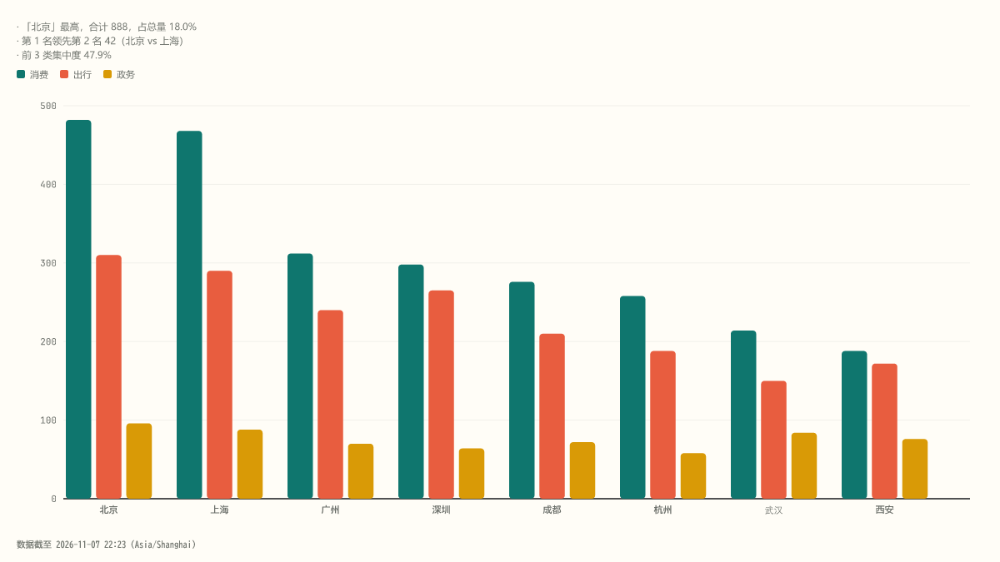

# Virta

**简体中文** · [English](README.en.md)

> Data in motion.

**Virta** 是一个离线优先、Agent 友好的可视化 CLI：读一份 CSV/JSON/XLSX（或 Markdown 文档），自动识别结构、推荐视图、给出中文洞察，产出**零依赖单文件 HTML**（离线可开、可交互）与 SVG/PNG 静态图。



## 安装

要求 Node ≥ 22。从 GitHub Release 安装 tarball（无需 clone 仓库）：

```bash
npm i -g https://github.com/hfut2014211610/virta/releases/download/v0.2.0/virta-0.2.0.tgz
virta doctor    # 环境自检：Node / resvg / 运行期脚本 / 字体 / CJK 字形 / 临时目录
```

`doctor` 任一 error 时先按提示修复再使用。

## 5 分钟上手

<!--readme-smoke-->
```bash
virta --version
virta doctor
virta list
virta render @samples/sample-multi.csv --export html,svg,png --out ./out --json
virta demo retail --out ./virta-demo --json
virta guide
virta skill path
virta skill install --dir ./skills
```

- `@samples/` 前缀引用内置样例（如 `@samples/sample-multi.csv`），任意目录可用。
- `virta demo <pack>` 用内置场景包（retail / saas / quality / delivery / finance，`--all` 全量）一键产出故事页 + 联动仪表盘 + 卡片 PNG。
- stdin 用 `-`；`--data '<json>'` 内联传数据；`--json` 输出机器可读 envelope（回执 `files[]` 列出产物路径与大小）。

常用参数：`--view <视图|auto>`、`--export html,svg,png`、`--out dir`、`--theme light|dark`、`--palette signal|patina|mono`、`--set k=v`（如 `--set variant=stacked`）、`--spec <file.json>`（多列 mapping/derive/facet 一律写文件）、`--scale 2`、`--font-file <ttf>`、`--as-of <ISO>`、`--tz <IANA>`。

## Agent 接入

```bash
virta skill install --dir ~/.agents/skills     # Devin/Codex 等读 ~/.agents/skills 的工具
virta skill install --dir ~/.claude/skills     # Claude Code
virta skill install --dir <dir> --force        # 覆盖已有文件
virta skill path                               # 只打印内置 SKILL.md 路径
```

安装后 Agent 按标准流程工作：`virta inspect <input> --json`（画像+推荐候选）→ `virta validate <input> --view <v> --json`（校验+suggestions）→ `virta render --json`（回执 insights/summaryMd/files）。**先 inspect，不要猜列名。**

## 图表目录（35 个视图）

`virta list` 查看别名与变体。

<!--views-start-->
| 类别 | 视图 |
|---|---|
| 基础 | bar · line · pie · combo · compare · rank · bullet · kpi |
| 分布 | histogram · boxplot · scatter |
| 构成 | funnel · heatmap · sunburst · treemap |
| 关系 | sankey · network · tree · fishbone |
| 时间/计划 | gantt · cohort · control |
| 多维 | radar · parallel · grid · matrix3d · scatter3d · line3d · pie3d |
| 文档 | report |
| 简版 | burndown · er · flowchart · sequence · formula |
<!--views-end-->

另有 spec 层 `facet` 小多图（bar/line/scatter/histogram/compare）。地图本期不做（预留）。

## 排障

| 症状 | 处理 |
|---|---|
| PNG 中文缺字（doctor 报 cjk warn） | Linux 安装 `fonts-noto-cjk`，或 `--font-file <覆盖中文的 ttf>` |
| 安装时 `@resvg/resvg-js` 下载失败 | resvg 原生模块按平台分发；切换 npm 镜像（`npm config set registry <镜像>`）后重装 |
| Windows 上 `--set`/`--data` 引号被吃掉 | 复杂 spec 一律写文件用 `--spec <file.json>` |
| HTML 在严格 CSP 环境打不开 | 产物内嵌 `Content-Security-Policy`（script-src sha256 白名单），单文件零依赖，双击即可离线打开 |
| `gallery` 报 INPUT_NOT_FOUND | gallery 仅在源码仓库可用：`npm run gallery` |
| 其他环境问题 | 先跑 `virta doctor` 逐项定位 |

## 升级与卸载

```bash
npm i -g https://github.com/hfut2014211610/virta/releases/download/v<新版本>/virta-<新版本>.tgz   # 覆盖安装即升级
npm uninstall -g virta                                                                            # 卸载（virta/vt 一并移除）
```

回执结构和 CLI 参数的不兼容变更见 `CHANGELOG.md` 的 Breaking 小节。

## 许可证

MIT（`LICENSE`）。内置字体 Fraunces / JetBrains Mono 使用 OFL（`dist/fonts/` 内含许可证文本）。

开发者文档（构建/测试/仓库结构）见 `CONTRIBUTING.md`；计划与 ADR 见 `docs/`。
